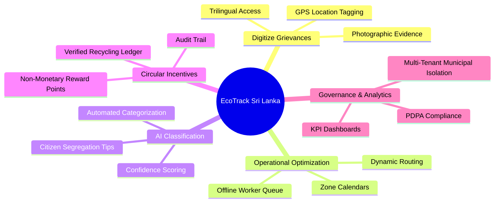
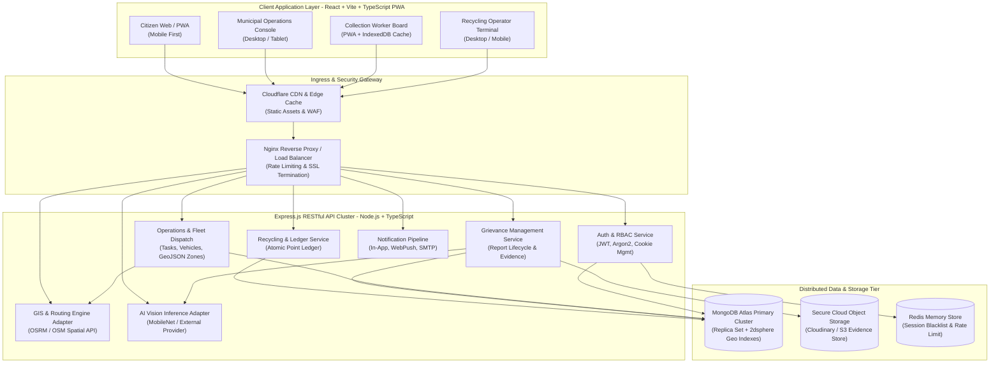
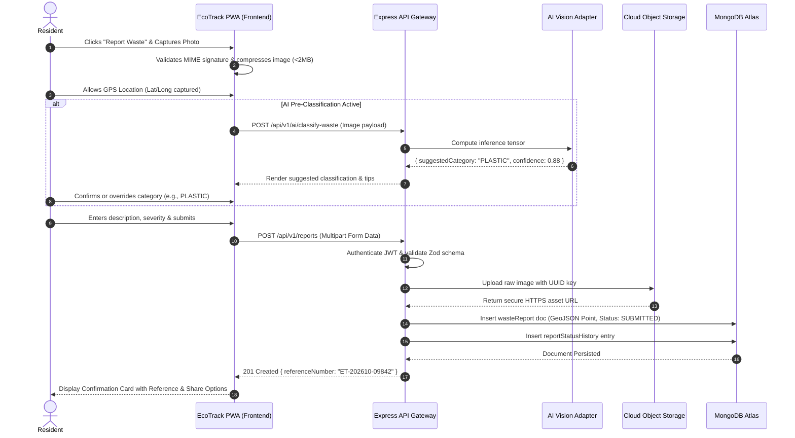
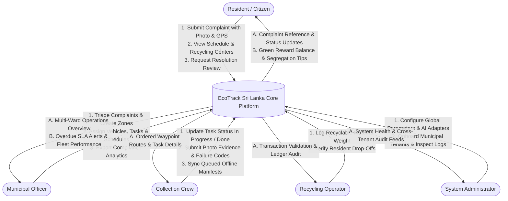
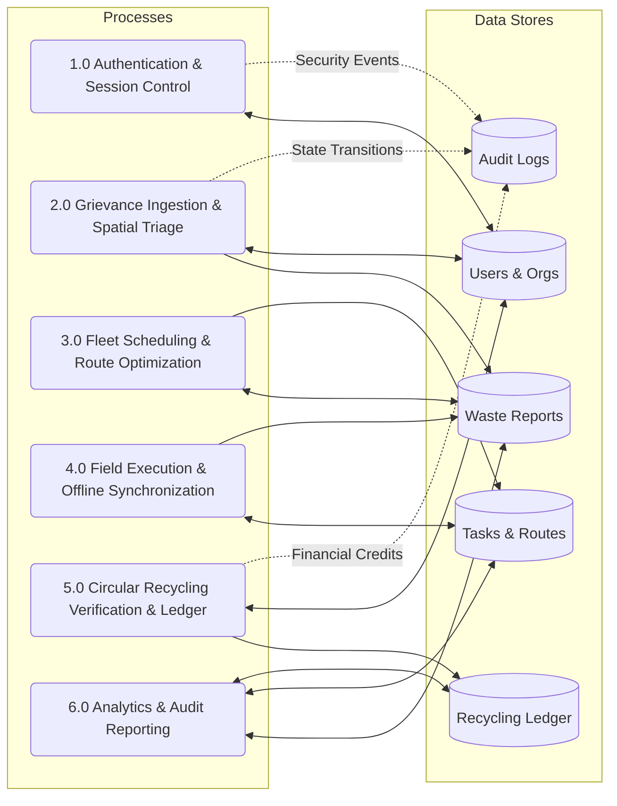
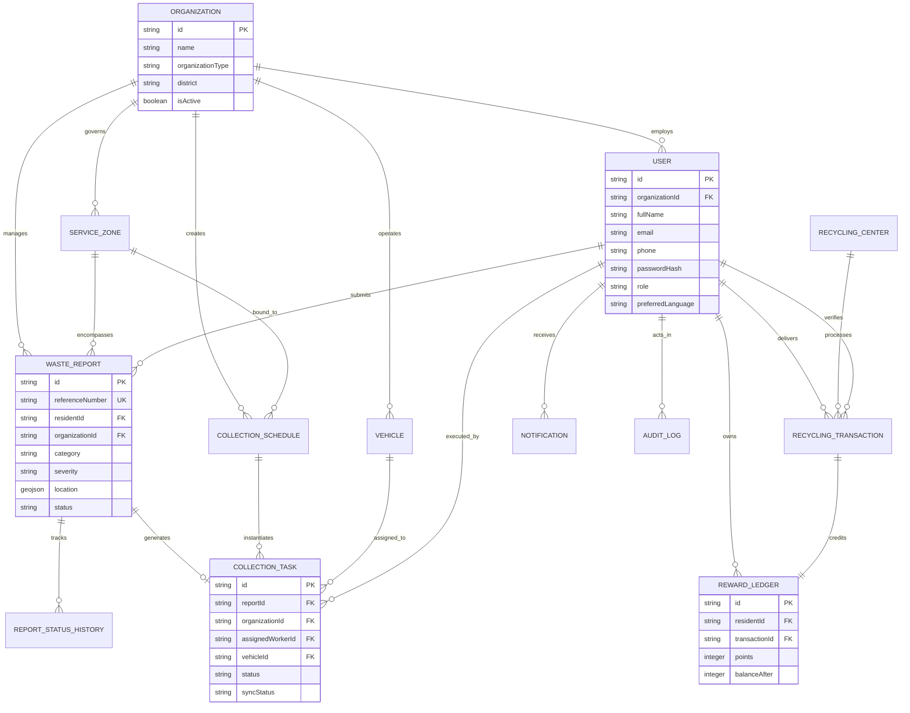
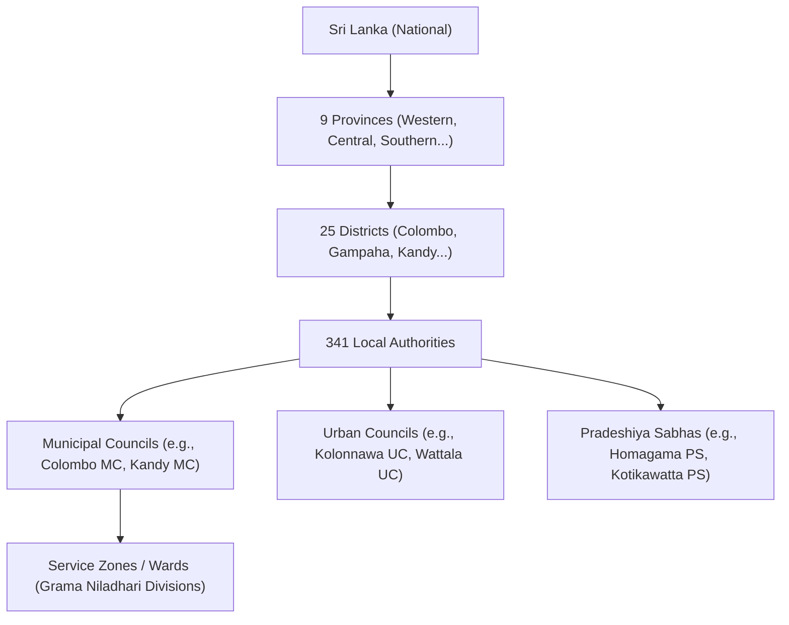
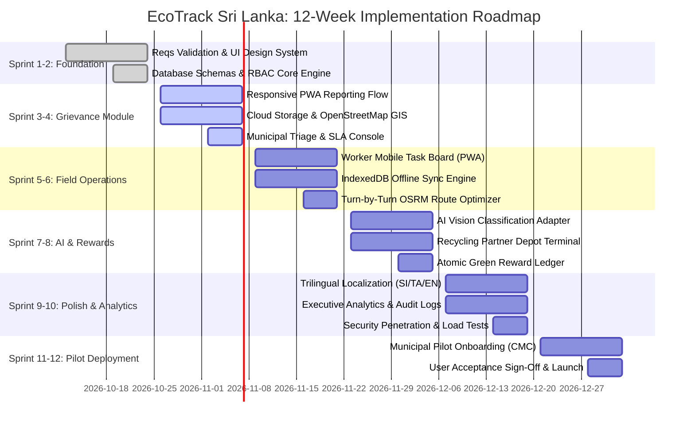

# SOFTWARE REQUIREMENTS SPECIFICATION (SRS)
## EcoTrack Sri Lanka: AI-Powered Smart Waste Management & Circular Recycling Platform

---

### Document Control & Metadata

| Attribute | Details |
| :--- | :--- |
| **Document Title** | Software Requirements Specification for EcoTrack Sri Lanka |
| **Document Version** | 1.0.0-RELEASE |
| **Status** | Approved Baseline Specification |
| **Project Name** | EcoTrack Sri Lanka (ස්මාර්ට් අපද්‍රව්‍ය කළමනාකරණ පද්ධතිය / ஸ்மார்ட் கழிவு மேலாண்மை அமைப்பு) |
| **Standard Compliance** | IEEE Std 830-1998 / ISO/IEC/IEEE 29148:2018 Systems and Software Engineering |
| **Target Platform** | Responsive Web Application & Progressive Web App (PWA) |
| **Target Country** | Democratic Socialist Republic of Sri Lanka |
| **Lead Architect** | Senior Software Architect & Business Analysis Group |
| **Timezone Reference** | `Asia/Colombo` (UTC+05:30) |
| **Legal Framework** | Sri Lanka Personal Data Protection Act (PDPA) No. 9 of 2022 & CEA Guidelines |

---

### Revision History

| Version | Date | Author / Role | Description of Changes |
| :--- | :--- | :--- | :--- |
| `0.1.0` | 2026-09-15 | Lead Business Analyst | Initial stakeholder interview compilation, field survey & operational scoping. |
| `0.5.0` | 2026-09-24 | Solutions Architect | System architecture, ER models, data dictionary, and security model design. |
| `0.9.0` | 2026-10-02 | Lead Full-Stack Architect | REST API v1 catalog, offline PWA synchronization specs, and UI/UX design tokens. |
| `1.0.0` | 2026-10-09 | Engineering Review Board | Final university- and enterprise-grade baseline sign-off with validation matrices. |

---

## 1. Executive Summary & Vision Statement

### 1.1 Executive Summary
Municipal solid waste management represents one of Sri Lanka's most critical public health, environmental, and municipal governance challenges. With over 10,700 metric tons of municipal solid waste generated daily across the Western Province and other urban centers, local authorities—encompassing Municipal Councils (*Maha Nagara Sabha*), Urban Councils (*Nagara Sabha*), and Pradeshiya Sabhas—struggle with low collection coverage, illegal open-air dumping, uncoordinated vehicle routing, lack of citizen accountability, and absent segregation incentives.

**EcoTrack Sri Lanka** is an enterprise-grade, cloud-native, AI-assisted waste governance platform and Progressive Web App (PWA) designed to modernize solid waste collection and community recycling across Sri Lankan administrative territories. Built on the modern MERN (MongoDB, Express, React, Node.js) architecture with TypeScript, EcoTrack bridges citizens, municipal sanitation directorates, field collection crews, and licensed recycling enterprises into a unified digital ecosystem.

### 1.2 Vision Statement
> *"To cultivate a cleaner, digitally connected, and ecologically resilient Sri Lanka by empowering citizens through friction-free waste reporting and verified circular recycling rewards, while equipping municipal councils with data-driven routing, predictive operations, and transparent environmental stewardship."*

---

## 2. Introduction & Project Objectives

### 2.1 Problem Statement
1. **Unmonitored Illegal Dumping & Littering:** Urban and peri-urban water canals, roadside reserves, and coastal belts suffer from unmonitored waste dumps with no formal mechanism for citizen grievance redressal.
2. **Operational Opacity in Local Authorities:** Municipal sanitation supervisors coordinate collection trucks, drivers, and laborers via ad-hoc phone calls or paper manifests, leading to fuel waste, missed zones, and unrecorded collection failures.
3. **Absence of Source Segregation Incentives:** Despite Central Environmental Authority (CEA) mandates for color-coded waste segregation, household compliance remains suboptimal due to the lack of tangible reward mechanisms.
4. **Lack of Recycling Network Visibility:** Citizens are unaware of formal recycling centers, their operating hours, and accepted recyclable fractions (e.g., HDPE, PET, e-waste, corrugated cardboard).
5. **Connectivity & Device Disparities:** Field workers and drivers encounter intermittent 3G/4G connectivity across peri-urban terrain, demanding resilient offline-first mobile capabilities.

### 2.2 Primary Project Objectives



1. **Digitize Waste Grievances:** Enable citizens to log georeferenced, photographic waste complaints in under 60 seconds with automated reference generation and lifecycle tracking.
2. **Empower Municipal Administration:** Furnish councils with a multi-tenant operations console to monitor complaints, prioritize hot-spots, dispatch collection assets, and maintain audit logs.
3. **Field Task Execution with Offline Resilience:** Equip drivers and collection laborers with a mobile PWA supporting turn-by-turn navigation, collection evidence capture, and background queue synchronization during network drops.
4. **Incorporate AI-Assisted Waste Segregation Guidance:** Provide computer vision heuristics to classify waste photographs, calculate confidence scores, and educate residents on segregating organic vs. recyclable fractions.
5. **Establish Auditable Circular Rewards:** Connect certified recycling aggregators with citizens, awarding verifiable green points for weighed recyclables under strict idempotency and anti-fraud ledger controls.
6. **Ensure Sri Lankan Contextual Suitability:** Native trilingual user experience (English, Sinhala, Tamil), optimized low-bandwidth asset delivery, and compliance with the Sri Lanka Personal Data Protection Act No. 9 of 2022.

---

## 3. Scope and System Boundaries

### 3.1 In-Scope Capabilities
- **Citizen / Resident Web & PWA Portal:** Trilingual self-registration, waste grievance submission with GPS and camera capture, calendar viewing, recycling center locator, reward point portfolio, and progress notifications.
- **Municipal Council Console:** Role-based management of wards/zones, complaints triage, vehicle fleet tracking, route review, collection schedule creation, and SLA performance reporting.
- **Field Worker & Driver PWA:** Mobile-optimized task board, daily route lists, before-and-after collection photo capture, failure reason logging, and IndexedDB-backed offline queue.
- **AI Classification Micro-Adapter:** Pluggable vision analysis API evaluating image tensors, inferring waste classes, outputting confidence scores, and flagging ambiguous images for human review.
- **GIS Mapping & Fleet Routing:** Leaflet/OpenStreetMap-driven spatial query engine, point-in-polygon zone allocation, and Open Source Routing Machine (OSRM) integration for multi-stop route optimization.
- **Recycling Partner Verification & Ledger:** Partner terminal for recording incoming recyclable consignments, issuing cryptographically isolated green reward credits, and auditing balances.
- **Security & Multi-Tenancy:** Hard tenant isolation ensuring a municipal council (e.g., Colombo Municipal Council) cannot view or modify records belonging to another (e.g., Dehiwala-Mount Lavinia Municipal Council).

### 3.2 Out-of-Scope (Non-Goals for Initial Baseline)
- Automated direct financial disbursement or cash payout integrations (banking KYC/payout rails).
- Hardware-based IoT sensor installations inside municipal bins (e.g., ultrasonic bin fill sensors) — system will, however, provide ingestion endpoints for future IoT telemetry.
- Autonomous dispatching of collection trucks without municipal supervisor approval.
- Direct enforcement or processing of legal fines/penalties against citizens for illegal dumping.

---

## 4. Stakeholders, User Personas, and Operational Context

### 4.1 Stakeholder Registry

| Stakeholder Group | Representation | Primary Interests & Concerns |
| :--- | :--- | :--- |
| **Citizens & Residents** | Urban & suburban householders, youth, apartment committees | Simple incident reporting, timely collection, transparency, data privacy, and meaningful recycling rewards. |
| **Municipal Councils** | Commissioners, Chief Public Health Inspectors (CPHI), Sanitation Engineers | Operational visibility, complaint resolution turnaround, worker attendance, fleet fuel efficiency, and public health metrics. |
| **Field Crews & Drivers** | Waste truck drivers, municipal laborers, contracted collectors | Clear route directions, non-intrusive mobile interface, offline task logging, and safety documentation. |
| **Recycling Operators** | Private paper/plastic aggregators, e-waste recyclers | Direct connection with households, verification of clean dry recyclables, fraud prevention in points issuance. |
| **Central Government** | Central Environmental Authority (CEA), Ministry of Provincial Councils | National waste diversion statistics, reduction in open dumping, compliance with national environmental charters. |
| **Platform Operators** | Cloud engineers, system administrators, security officers | High availability, API latency, tenant separation, multi-tier audit trails, and data protection compliance. |

### 4.2 User Personas

```
+----------------------------------------------------------------------------------------------------+
| PERSONA 1: Kasun Perera (Urban Resident - Colombo 05)                                              |
| Age: 34 | Language: Sinhala & English | Device: Mid-range Android smartphone (Samsung Galaxy A14)  |
| Goal: Report recurrent illegal garbage dumping in his canal lane and receive notification on pickup.|
| Frustration: Ineffective hotline calls to the council; no feedback loop or collection schedule clarity.|
+----------------------------------------------------------------------------------------------------+
| PERSONA 2: Eng. Shamila Mohamed (Sanitation Director - Colombo Municipal Council)                 |
| Age: 46 | Language: English & Tamil | Device: Desktop Workstation & iPad Pro                       |
| Goal: Allocate morning collection vehicles, monitor overdue complaints, and export monthly metrics. |
| Frustration: Paper-based collection logs; inability to verify if drivers covered their assigned zones.|
+----------------------------------------------------------------------------------------------------+
| PERSONA 3: Bandara Jayawardena (Collection Vehicle Driver)                                         |
| Age: 41 | Language: Sinhala | Device: Low-end ruggedized 4G smartphone (Redmi 9A)                   |
| Goal: View today's pickup points in order of distance and mark tasks completed without app crashes.|
| Frustration: Apps that fail when data connection drops; complicated forms with too much text input.|
+----------------------------------------------------------------------------------------------------+
```

---

## 5. User Roles and RBAC Matrix

The system mandates strict server-side Role-Based Access Control (RBAC). No privileged action is authorized based solely on frontend state.

### 5.1 Role Definitions
1. `RESIDENT`: Registered citizen with authority to submit and track own complaints, view collection schedules, locate recycling points, and manage own reward ledger.
2. `MUNICIPAL_OFFICER`: Sanitation inspector or operations director bound to a single municipal council tenant with authority to manage complaints, schedules, tasks, routes, vehicles, and analytics.
3. `COLLECTION_WORKER`: Sanitation crew member authorized to view assigned tasks, submit collection timestamps, and upload completion photo evidence.
4. `DRIVER`: Vehicle operator assigned to collection routes, authorized to view route stops, update navigation status, and log impassable route issues.
5. `RECYCLING_PARTNER`: Authorized agent of a licensed recycling facility permitted to verify recyclable material drop-offs and issue verified rewards to residents.
6. `SYSTEM_ADMIN`: Platform-wide administrative operator managing global parameters, organization onboarding, system health, and cross-tenant audit trails.

### 5.2 Server-Enforced RBAC Permission Matrix

| Module / Operation | RESIDENT | MUNICIPAL_OFFICER | COLLECTION_WORKER | DRIVER | RECYCLING_PARTNER | SYSTEM_ADMIN |
| :--- | :---: | :---: | :---: | :---: | :---: | :---: |
| **Self-Registration & Profile Edit** | `CRUD (Own)` | `R (Own)` | `R (Own)` | `R (Own)` | `R (Own)` | `CRUD (All)` |
| **Submit Waste Report** | `Create` | `Create` | `-` | `-` | `-` | `Create` |
| **View Waste Reports** | `R (Own)` | `R (Org Scope)` | `R (Assigned)` | `R (Assigned)` | `-` | `R (All)` |
| **Triage & Assign Report** | `-` | `Update (Org)` | `-` | `-` | `-` | `Update (All)`|
| **Update Complaint Status** | `-` | `Update (Org)` | `Update (Task)` | `Update (Task)`| `-` | `Update (All)`|
| **Upload Task Evidence Photo**| `-` | `Upload` | `Upload (Task)`| `Upload (Task)`| `-` | `Upload (All)`|
| **Request Resolution Review** | `Create (Own)` | `Review` | `-` | `-` | `-` | `Review` |
| **Manage Schedules & Zones** | `Read` | `CRUD (Org)` | `Read` | `Read` | `-` | `CRUD (All)` |
| **Optimize & Assign Routes** | `-` | `Create/Update`| `-` | `Read (Assigned)`| `-` | `Create/Update`|
| **Submit Recyclables Receipt**| `Read (Own)` | `-` | `-` | `-` | `Create/Verify` | `Audit` |
| **Green Ledger Issuance** | `-` | `-` | `-` | `-` | `Create (Atomic)`| `Audit/Rollback`|
| **Export Analytics Reports** | `-` | `Export (Org)` | `-` | `-` | `Export (Own)` | `Export (All)` |
| **View System Audit Logs** | `-` | `Read (Org)` | `-` | `-` | `-` | `Read (Global)`|
| **Manage Organizations & AI** | `-` | `-` | `-` | `-` | `-` | `CRUD (Global)`|

*Note: All database queries must inject `organizationId: user.organizationId` for `MUNICIPAL_OFFICER`, `COLLECTION_WORKER`, and `DRIVER` roles to enforce tenant boundaries at the database layer.*

---

## 6. Functional Requirements (FR)

Every functional requirement is assigned an unambiguous, traceable identifier.

### 6.1 Authentication & Profile Management (`FR-AUTH`)
- **`FR-AUTH-001` User Registration:** The system shall allow residents to register an account using full name, email, Sri Lankan mobile phone number (`+94XXXXXXXXX` format), preferred language (`en`, `si`, `ta`), and password.
- **`FR-AUTH-002` Password Hashing:** Passwords shall be cryptographically hashed prior to storage using `Argon2id` (memory cost 65536 KiB, time cost 3, parallelism 1) or `bcrypt` with a minimum cost factor of 12.
- **`FR-AUTH-003` Session Management:** The system shall implement authentication via short-lived JWT Access Tokens (15-minute expiry) and rotating Refresh Tokens (7-day expiry) stored inside `HttpOnly`, `SameSite=Strict`, `Secure` cookies.
- **`FR-AUTH-004` Password Recovery:** The system shall provide a secure password reset workflow generating a cryptographically random, single-use, SHA-256-hashed reset token valid for 60 minutes.
- **`FR-AUTH-005` Brute-Force Rate Limiting:** The backend shall lock login attempts after 5 consecutive failed attempts per IP/Email for an exponential cooldown period of 15 minutes.
- **`FR-AUTH-006` Multilingual Preference Persistence:** The user's language selection (`en`, `si`, `ta`) shall be persisted to the database and synced with client state across all sessions.

### 6.2 Citizen Waste Grievance & Reporting (`FR-CIT`)
- **`FR-CIT-001` Complaint Creation:** Residents shall submit a waste complaint with category, description, severity level (`LOW`, `MEDIUM`, `HIGH`, `CRITICAL`), GPS coordinates, and 1 to 5 photographic evidence files.
- **`FR-CIT-002` Reference Generation:** Upon submission, the system shall assign a unique, non-guessable alphanumeric reference in the format `ET-YYYYMM-XXXXX` (e.g., `ET-202610-09842`).
- **`FR-CIT-003` Geolocation Capture:** The system shall capture coordinates via the browser's HTML5 Geolocation API with fallback to manual interactive marker placement on an OpenStreetMap interface.
- **`FR-CIT-004` Image Upload Constraints:** Uploads shall be validated using file magic-byte signatures (JPEG, PNG, WebP) with a maximum individual file size of 5 MB and maximum aggregate payload of 20 MB.
- **`FR-CIT-005` Lifecycle Tracking:** Residents shall have real-time visibility into complaint progression across states: `SUBMITTED`, `UNDER_REVIEW`, `APPROVED`, `ASSIGNED`, `IN_PROGRESS`, `RESOLVED`, `REJECTED`.
- **`FR-CIT-006` Review Escalation:** If a complaint is flagged `RESOLVED` but the physical waste remains uncollected, the resident shall have 72 hours to initiate a `REVIEW_REQUESTED` action with fresh photographic proof.

### 6.3 Municipal Operations & Fleet Administration (`FR-MUN`)
- **`FR-MUN-001` Multi-Tenant Complaint Console:** Municipal officers shall only access complaints located within their council's geofenced jurisdiction (`organizationId`).
- **`FR-MUN-002` Complaint Triage:** Officers shall have capabilities to accept, adjust category/severity, assign to collection zones, or reject invalid complaints with a documented justification.
- **`FR-MUN-003` Zone & Ward Boundary Management:** Officers shall define geographic service zones using GeoJSON Polygons and associate them with collection calendars.
- **`FR-MUN-004` Vehicle & Crew Allocation:** The system shall maintain records of sanitation vehicles (registration number, fuel type, volume capacity in metric tons/cubic meters) and assign designated drivers and laborers.
- **`FR-MUN-005` SLA Escalation Alerts:** Complaints unassigned after 24 hours or uncollected after 72 hours shall automatically transition to `OVERDUE` state with dashboard visual alerts and supervisor notifications.
- **`FR-MUN-006` Exportable Environmental Reporting:** The platform shall generate localized PDF and CSV compliance reports detailing collection volumes, clearance velocity, and ward-by-ward metrics.

### 6.4 Field Operations & Worker PWA (`FR-WRK`)
- **`FR-WRK-001` Daily Task Manifest:** Workers/drivers shall view a prioritized daily manifest of assigned collection waypoints ordered by proximity and priority.
- **`FR-WRK-002` Task Status Transitions:** Field staff shall update tasks to `IN_PROGRESS`, `COMPLETED`, or `FAILED`.
- **`FR-WRK-003` Completion Evidence:** Marking a task `COMPLETED` shall strictly require capturing at least one post-cleanup photograph with client-side GPS and timestamp embedding.
- **`FR-WRK-004` Failure Justification:** Marking a task `FAILED` shall require selecting an operational reason code (`ROAD_BLOCKED`, `HAZARDOUS_ACCESS`, `WASTE_REMOVED_BY_CITIZEN`, `EXCEEDS_TRUCK_CAPACITY`) and an optional memo.
- **`FR-WRK-005` Offline Persistence:** The PWA shall cache the current day's active task manifest within client-side IndexedDB, allowing workers to review tasks, navigate, and capture completion photos without network coverage.
- **`FR-WRK-006` Background Sync:** When network connectivity is re-established, the PWA shall flush queued updates via `POST /api/v1/collection-tasks/sync` with client-generated UUID idempotency keys.

### 6.5 AI-Assisted Waste Classification (`FR-AI`)
- **`FR-AI-001` Image Inference Pipeline:** The system shall ingest uploaded waste images through a modular computer vision adapter service (supporting MobileNetV3 / ResNet-50 / EfficientNet / Cloud AI API).
- **`FR-AI-002` Classification Output:** The inference engine shall return predicted waste category (`ORGANIC`, `PAPER`, `PLASTIC`, `GLASS`, `METAL`, `E_WASTE`, `CONSTRUCTION`, `HAZARDOUS`, `MIXED`) with a confidence score between `0.00` and `1.00`.
- **`FR-AI-003` Ambiguity Flagging:** Any inference returning a confidence score `< 0.65` shall be marked `requiresHumanReview: true`, prompting the citizen to manually confirm the category.
- **`FR-AI-004` Safety Override for Hazardous Materials:** The system shall never programmatically declare unidentified chemical, biomedical, or asbestos waste as `SAFE` based solely on vision heuristics.
- **`FR-AI-005` Graceful Fallback:** If the AI inference service times out (> 4000ms) or is unreachable, the reporting workflow shall proceed seamlessly with manual category selection.

### 6.6 GIS Mapping & Route Optimization (`FR-GIS`)
- **`FR-GIS-001` Interactive Spatial Map:** The system shall display Leaflet-powered maps rendering reports, service zone boundaries, recycling centers, and vehicle routes with custom categorized pins.
- **`FR-GIS-002` Spatial Clustering:** Dense clusters of complaints shall be aggregated using client-side marker clustering (`leaflet.markercluster`) to maintain 60 FPS map panning performance.
- **`FR-GIS-003` Multi-Stop Route Optimization:** The system shall interface with an OSRM (Open Source Routing Machine) or equivalent routing engine to sequence up to 50 collection waypoints per vehicle based on road distance and truck payload.
- **`FR-GIS-004` Turn-by-Turn Waypoint Geometry:** The optimized route response shall supply ordered waypoint nodes, total distance in kilometers, estimated travel time, and GeoJSON `LineString` route geometry.

### 6.7 Recycling Center Locator & Circular Rewards (`FR-REC`)
- **`FR-REC-001` Recycling Facility Directory:** The public directory shall catalogue verified recycling facilities, listing accepted waste streams, operational hours, contact telephone, and geocoded coordinates.
- **`FR-REC-002` Proximity Search:** Citizens shall query recycling centers within an adjustable radial distance (1 km to 25 km) calculated via MongoDB `$near` geospatial operators.
- **`FR-REC-003` Transaction Verification:** Authorized recycling operators shall log resident drop-offs specifying material type (`PET`, `HDPE`, `CARDBOARD`, `METALS`, `E_WASTE`) and measured weight (kg).
- **`FR-REC-004` Cryptographic Reward Ledger:** Green Points shall be credited to the resident's account via an atomic, immutable double-entry ledger calculation (`RewardLedger`) preventing double-spend exploits.
- **`FR-REC-005` Point Accrual Rules:** Point multipliers per kilogram shall be dynamically configurable by municipal policy (e.g., 1 kg Clean PET = 10 Points; 1 kg E-waste = 50 Points).

### 6.8 Notifications & Citizen Engagement (`FR-NOTIF`)
- **`FR-NOTIF-001` In-App Notification Center:** The platform shall provide an in-app notification repository tracking status updates, calendar shifts, and reward allocations.
- **`FR-NOTIF-002` Web Push Delivery:** The PWA shall register standard W3C Push Service Workers for real-time mobile push delivery when permitted by the user.
- **`FR-NOTIF-003` Email Dispatch:** System transactional emails (welcome verification, password recovery, complaint resolution notices) shall be dispatched via standard SMTP/SendGrid adapters.

### 6.9 Governance, Audit & Analytics (`FR-ANL`)
- **`FR-ANL-001` Operational Dashboards:** Municipal supervisors shall view real-time KPIs: Daily Complaints Logged, Cleared Volume (MT), Average Resolution Time (Hours), and Ward SLA compliance.
- **`FR-ANL-002` Security Audit Logging:** Every privileged action (role modification, complaint deletion, task reassignment, reward adjustment) shall generate an immutable `AuditLog` entry containing actor ID, IP address, timestamp, previous state, and new state.
- **`FR-ANL-003` Data Redaction in Logs:** Logs must systematically scrub sensitive credentials, passwords, JWT tokens, and national identity numbers before persistence.

---

## 7. System Architecture & Component Design

The platform adopts a decoupled, multi-tenant MERN architecture optimized for containerized cloud deployment and low-bandwidth client environments.



---

## 8. Detailed Use Cases & Workflows

### 8.1 Primary Use Case Index

| Use Case ID | Name | Primary Actor | Trigger |
| :--- | :--- | :--- | :--- |
| `UC-CIT-01` | Submit Waste Complaint with Photo & GPS | Resident | Citizen encounters uncollected garbage or illegal dump site. |
| `UC-CIT-02` | Request Complaint Resolution Review | Resident | Citizen observes complaint closed prematurely without pickup. |
| `UC-MUN-01` | Triage, Assign and Route Collection Tasks | Municipal Officer | Officer reviews daily queue of pending complaints. |
| `UC-WRK-01` | Execute Collection Task with Offline Sync | Collection Worker | Field worker arrives at waste pickup location. |
| `UC-REC-01` | Verify Recyclable Batch & Credit Reward | Recycling Partner | Resident delivers recyclable dry materials to depot. |

---

### 8.2 Detailed Workflow: `UC-CIT-01` Submit Waste Complaint



---

### 8.3 Detailed Workflow: `UC-WRK-01` Field Task Execution & Offline Sync

```mermaid
sequenceDiagram
    autonumber
    actor Worker as Field Driver/Laborer
    participant PWA as Worker PWA (IndexedDB)
    participant API as Express API Gateway
    participant DB as MongoDB Atlas

    Note over Worker,PWA: Online Phase: Morning Manifest Loading
    Worker->>PWA: Authenticates and views "Today's Tasks"
    PWA->>API: GET /api/v1/collection-tasks/my-tasks
    API->>DB: Query assigned tasks (populate routes & locations)
    DB-->>API: Returns task array
    API-->>PWA: 200 OK (Task Manifest)
    PWA->>PWA: Persist tasks into IndexedDB 'tasks' store

    Note over Worker,PWA: Offline Phase: Out in Low-Connectivity Zone
    Worker->>PWA: Navigates to waypoint; collects waste pile
    Worker->>PWA: Takes "After-Collection" evidence photo
    Worker->>PWA: Marks Task "COMPLETED"
    PWA->>PWA: Detects navigator.onLine == false
    PWA->>PWA: Saves completion state + base64 photo to IndexedDB 'syncQueue'
    PWA-->>Worker: Shows "Saved Offline - Queued for Sync" (Amber Badge)

    Note over Worker,PWA: Reconnection Phase: Truck Returns to Depot (4G Active)
    PWA->>PWA: Window event 'online' triggered
    PWA->>API: POST /api/v1/collection-tasks/sync (Payload: queued updates + idempotencyKey)
    API->>API: Validate idempotencyKey & worker session
    API->>DB: Update CollectionTask status to COMPLETED & save evidence URL
    API->>DB: Transition linked WasteReport to RESOLVED
    DB-->>API: Atomic update acknowledged
    API-->>PWA: 200 OK { syncedCount: 1, failedCount: 0 }
    PWA->>PWA: Clear processed items from IndexedDB 'syncQueue'
    PWA-->>Worker: Displays "All Tasks Successfully Synchronized" (Green Badge)
```

---

## 9. Data Flow Diagrams (DFD)

### 9.1 DFD Level 0: Context Diagram



---

### 9.2 DFD Level 1: System Operational Decomposition



---

## 10. Database Entity-Relationship (ER) Architecture

The entity relationships capture multi-tenant municipal boundaries, spatial geometry, fleet dispatch, and immutable green ledgers.



---

## 11. MongoDB Collection Specifications & Data Dictionary

The database design adheres to strict BSON typing, geospatial indexes (`2dsphere`), compound query optimization, and referential integrity constraints.

### 11.1 Collection: `users`
- **Purpose:** Central store for all authenticated personas across residents, municipal personnel, drivers, and partners.
- **Indexes:**
  - `{ email: 1 }` (Unique)
  - `{ phone: 1 }` (Sparse, Unique)
  - `{ organizationId: 1, role: 1 }` (Compound)

```json
{
  "_id": { "$oid": "67064d1a1f3a8b2a1c000001" },
  "organizationId": { "$oid": "67064d1a1f3a8b2a1c000099" },
  "fullName": "Sunil Jayakody",
  "email": "sunil.j@colombo.mc.gov.lk",
  "phone": "+94771234567",
  "passwordHash": "$argon2id$v=19$m=65536,t=3,p=1$...",
  "role": "MUNICIPAL_OFFICER",
  "preferredLanguage": "si",
  "profileImage": "https://res.cloudinary.com/ecotrack/users/u-001.webp",
  "isEmailVerified": true,
  "isActive": true,
  "createdAt": { "$date": "2026-10-01T04:30:00.000Z" },
  "updatedAt": { "$date": "2026-10-09T03:15:00.000Z" }
}
```

### 11.2 Collection: `organizations`
- **Purpose:** Tenant registry representing Municipal Councils, Urban Councils, Pradeshiya Sabhas, and licensed Recycling Consortia.
- **Indexes:**
  - `{ name: 1 }` (Unique)
  - `{ district: 1, organizationType: 1 }`

```json
{
  "_id": { "$oid": "67064d1a1f3a8b2a1c000099" },
  "name": "Colombo Municipal Council",
  "organizationType": "MUNICIPAL_COUNCIL",
  "district": "Colombo",
  "address": "Town Hall, Colombo 07, Sri Lanka",
  "contactDetails": {
    "phone": "+94112693151",
    "email": "info@colombo.mc.gov.lk",
    "website": "https://colombo.mc.gov.lk"
  },
  "isActive": true,
  "createdAt": { "$date": "2026-09-01T00:00:00.000Z" },
  "updatedAt": { "$date": "2026-10-01T00:00:00.000Z" }
}
```

### 11.3 Collection: `serviceZones`
- **Purpose:** Geofenced administrative wards or sanitation operational zones governed by a municipal body.
- **Indexes:**
  - `{ organizationId: 1, name: 1 }` (Unique compound)
  - `{ boundary: "2dsphere" }` (Geospatial polygon index)

```json
{
  "_id": { "$oid": "67064d1a1f3a8b2a1c000101" },
  "organizationId": { "$oid": "67064d1a1f3a8b2a1c000099" },
  "name": "District 2B - Cinnamon Gardens & Kollupitiya",
  "district": "Colombo",
  "localAuthority": "Colombo Municipal Council",
  "boundary": {
    "type": "Polygon",
    "coordinates": [
      [
        [79.8510, 6.9120],
        [79.8650, 6.9120],
        [79.8650, 6.8980],
        [79.8510, 6.8980],
        [79.8510, 6.9120]
      ]
    ]
  },
  "isActive": true
}
```

### 11.4 Collection: `wasteReports`
- **Purpose:** Central grievance record tracking citizen waste complaints from creation to certified resolution.
- **Indexes:**
  - `{ referenceNumber: 1 }` (Unique)
  - `{ location: "2dsphere" }` (Geospatial point index)
  - `{ organizationId: 1, status: 1, createdAt: -1 }` (Triage compound)
  - `{ residentId: 1, createdAt: -1 }` (Citizen portfolio compound)

```json
{
  "_id": { "$oid": "67064d1a1f3a8b2a1c000201" },
  "referenceNumber": "ET-202610-09842",
  "residentId": { "$oid": "67064d1a1f3a8b2a1c000002" },
  "organizationId": { "$oid": "67064d1a1f3a8b2a1c000099" },
  "serviceZoneId": { "$oid": "67064d1a1f3a8b2a1c000101" },
  "category": "PLASTIC",
  "description": "Large accumulation of single-use plastic bottles clogging the roadside storm drain.",
  "severity": "HIGH",
  "images": [
    "https://res.cloudinary.com/ecotrack/reports/et-09842-1.webp"
  ],
  "location": {
    "type": "Point",
    "coordinates": [79.8584, 6.9042]
  },
  "address": "Opposite 42 Dharmapala Mawatha, Colombo 07",
  "aiClassification": {
    "suggestedCategory": "PLASTIC",
    "confidence": 0.89,
    "requiresHumanReview": false,
    "evaluatedAt": { "$date": "2026-10-09T04:15:10.000Z" }
  },
  "status": "ASSIGNED",
  "assignedTaskId": { "$oid": "67064d1a1f3a8b2a1c000301" },
  "statusHistory": [
    {
      "status": "SUBMITTED",
      "changedBy": { "$oid": "67064d1a1f3a8b2a1c000002" },
      "notes": "Initial grievance submission.",
      "timestamp": { "$date": "2026-10-09T04:15:12.000Z" }
    },
    {
      "status": "ASSIGNED",
      "changedBy": { "$oid": "67064d1a1f3a8b2a1c000001" },
      "notes": "Dispatched to Route 04 morning crew.",
      "timestamp": { "$date": "2026-10-09T04:30:00.000Z" }
    }
  ],
  "createdAt": { "$date": "2026-10-09T04:15:12.000Z" },
  "updatedAt": { "$date": "2026-10-09T04:30:00.000Z" }
}
```

### 11.5 Collection: `collectionTasks`
- **Purpose:** Discrete operational work-order assigned to field workers/drivers to remediate a report or execute scheduled clearance.
- **Indexes:**
  - `{ organizationId: 1, status: 1 }`
  - `{ assignedDriverId: 1, scheduledAt: 1 }`
  - `{ assignedWorkerId: 1, scheduledAt: 1 }`

```json
{
  "_id": { "$oid": "67064d1a1f3a8b2a1c000301" },
  "reportId": { "$oid": "67064d1a1f3a8b2a1c000201" },
  "organizationId": { "$oid": "67064d1a1f3a8b2a1c000099" },
  "assignedWorkerId": { "$oid": "67064d1a1f3a8b2a1c000003" },
  "assignedDriverId": { "$oid": "67064d1a1f3a8b2a1c000004" },
  "vehicleId": { "$oid": "67064d1a1f3a8b2a1c000401" },
  "scheduledAt": { "$date": "2026-10-09T08:00:00.000Z" },
  "priority": "HIGH",
  "status": "IN_PROGRESS",
  "failureReason": null,
  "completionEvidence": [],
  "completedAt": null,
  "syncStatus": "SYNCED",
  "createdAt": { "$date": "2026-10-09T04:30:00.000Z" }
}
```

### 11.6 Collection: `vehicles`
- **Purpose:** Fleet catalog tracking waste compactor trucks, tractors, and tippers.
- **Indexes:**
  - `{ registrationNumber: 1 }` (Unique)
  - `{ organizationId: 1, status: 1 }`

```json
{
  "_id": { "$oid": "67064d1a1f3a8b2a1c000401" },
  "organizationId": { "$oid": "67064d1a1f3a8b2a1c000099" },
  "registrationNumber": "WP-DA-4892",
  "vehicleType": "COMPACTOR_TRUCK",
  "capacity": 7.5,
  "capacityUnit": "METRIC_TON",
  "status": "ACTIVE",
  "assignedDriverId": { "$oid": "67064d1a1f3a8b2a1c000004" }
}
```

### 11.7 Collection: `recyclingCenters`
- **Purpose:** Public directory of accredited drop-off depots and circular processing centers.
- **Indexes:**
  - `{ location: "2dsphere" }`
  - `{ organizationId: 1, isActive: 1 }`

```json
{
  "_id": { "$oid": "67064d1a1f3a8b2a1c000501" },
  "name": "EcoSpindles Plastic Aggregation Hub",
  "organizationId": { "$oid": "67064d1a1f3a8b2a1c000088" },
  "location": {
    "type": "Point",
    "coordinates": [79.8712, 6.8911]
  },
  "address": "15 Baseline Road, Kirulapone, Colombo 05",
  "acceptedMaterials": ["PLASTIC", "PAPER", "METAL"],
  "openingHours": "Mon-Sat: 08:30 - 17:00",
  "contactDetails": {
    "phone": "+94112508899",
    "email": "depot@ecospindles.lk"
  },
  "isActive": true
}
```

### 11.8 Collection: `recyclingTransactions`
- **Purpose:** Verified transactional intake of recyclable consignments submitted by residents to authorized partners.
- **Indexes:**
  - `{ idempotencyKey: 1 }` (Unique)
  - `{ residentId: 1, createdAt: -1 }`
  - `{ recyclingCenterId: 1, createdAt: -1 }`

```json
{
  "_id": { "$oid": "67064d1a1f3a8b2a1c000601" },
  "idempotencyKey": "rec-tx-9d7a2f1c-4389-4e01",
  "residentId": { "$oid": "67064d1a1f3a8b2a1c000002" },
  "recyclingCenterId": { "$oid": "67064d1a1f3a8b2a1c000501" },
  "verifiedBy": { "$oid": "67064d1a1f3a8b2a1c000005" },
  "materials": [
    {
      "category": "PLASTIC",
      "subType": "PET_BOTTLES",
      "quantity": 4.5,
      "quantityUnit": "KG",
      "pointsPerUnit": 10,
      "awardedPoints": 45
    }
  ],
  "verificationStatus": "VERIFIED",
  "totalRewardPoints": 45,
  "verifiedAt": { "$date": "2026-10-08T10:14:00.000Z" }
}
```

### 11.9 Collection: `rewardLedger`
- **Purpose:** Immutable financial-style accounting ledger recording every green point credit or debit with running balances.
- **Indexes:**
  - `{ residentId: 1, createdAt: -1 }`
  - `{ transactionId: 1 }` (Unique)

```json
{
  "_id": { "$oid": "67064d1a1f3a8b2a1c000701" },
  "residentId": { "$oid": "67064d1a1f3a8b2a1c000002" },
  "transactionId": { "$oid": "67064d1a1f3a8b2a1c000601" },
  "transactionType": "CREDIT",
  "points": 45,
  "balanceAfter": 320,
  "description": "Recycling Credit: 4.5 kg PET plastic verified at Kirulapone Hub",
  "createdAt": { "$date": "2026-10-08T10:14:02.000Z" }
}
```

### 11.10 Collection: `auditLogs`
- **Purpose:** Security and compliance log capturing all privileged transitions.
- **Indexes:**
  - `{ organizationId: 1, timestamp: -1 }`
  - `{ actorId: 1, timestamp: -1 }`
  - `{ resourceType: 1, resourceId: 1 }`

```json
{
  "_id": { "$oid": "67064d1a1f3a8b2a1c000801" },
  "actorId": { "$oid": "67064d1a1f3a8b2a1c000001" },
  "organizationId": { "$oid": "67064d1a1f3a8b2a1c000099" },
  "action": "REPORT_STATUS_TRANSITION",
  "resourceType": "WasteReport",
  "resourceId": "ET-202610-09842",
  "requestId": "req-88bf-921a43",
  "ipAddress": "192.248.45.10",
  "metadata": {
    "fromStatus": "SUBMITTED",
    "toStatus": "ASSIGNED",
    "assignedVehicle": "WP-DA-4892"
  },
  "timestamp": { "$date": "2026-10-09T04:30:00.000Z" }
}
```

---

## 12. RESTful API Specification (v1 Baseline)

All endpoints conform to the root prefix `/api/v1` and return standardized JSON envelopes.

### 12.1 Standard API Response Schema

#### Success Response Envelope (`HTTP 200 / 201`)
```json
{
  "success": true,
  "message": "Resource retrieved successfully",
  "data": {},
  "meta": {
    "page": 1,
    "limit": 20,
    "totalRecords": 142,
    "totalPages": 8
  }
}
```

#### Error Response Envelope (`HTTP 400 / 401 / 403 / 404 / 409 / 422 / 500`)
```json
{
  "success": false,
  "message": "Validation failed on incoming request payload",
  "error": {
    "code": "VALIDATION_ERROR",
    "details": [
      {
        "field": "location.coordinates",
        "issue": "Longitude must reside between 79.5 and 82.0 for Sri Lanka"
      }
    ]
  },
  "meta": null
}
```

---

### 12.2 Comprehensive Endpoint Catalog

| Method | Endpoint | Authorized Roles | Description & Requirements |
| :--- | :--- | :--- | :--- |
| **Authentication Module** | | | |
| `POST` | `/api/v1/auth/register` | Public | Register new resident. Auto-assigns `RESIDENT` role. |
| `POST` | `/api/v1/auth/login` | Public | Authenticates credentials; issues `HttpOnly` JWT cookie pair. |
| `POST` | `/api/v1/auth/logout` | Authenticated | Clears auth cookies; blacklists refresh token in Redis. |
| `POST` | `/api/v1/auth/refresh` | Public (Cookie) | Rotates refresh token; issues fresh 15-minute access token. |
| `POST` | `/api/v1/auth/forgot-password` | Public | Dispatches single-use password reset link via SMTP. |
| `POST` | `/api/v1/auth/reset-password` | Public | Validates reset token and updates password hash. |
| `GET` | `/api/v1/auth/me` | Authenticated | Retrieves current authenticated session user profile. |
| **Waste Grievance Module** | | | |
| `POST` | `/api/v1/reports` | `RESIDENT`, `MUNICIPAL_OFFICER` | Creates waste complaint with images, GPS, and category. |
| `GET` | `/api/v1/reports` | Authenticated | Paginated query (filtered by ownership or tenant scope). |
| `GET` | `/api/v1/reports/:id` | Authenticated | Retrieves complaint detail, image URLs, and history timeline. |
| `PATCH`| `/api/v1/reports/:id/status` | `MUNICIPAL_OFFICER`, `SYSTEM_ADMIN` | Updates complaint status (`APPROVED`, `REJECTED`, etc.). |
| `POST` | `/api/v1/reports/:id/review-request` | `RESIDENT` | Requests review if complaint was resolved prematurely. |
| `GET` | `/api/v1/reports/nearby` | Authenticated | Geospatial `$near` radius query (max 10 km). |
| **AI Inference Module** | | | |
| `POST` | `/api/v1/ai/classify-waste` | Authenticated | Analyzes image tensor and returns inferred waste category. |
| **Fleet & Operations Module** | | | |
| `GET` | `/api/v1/schedules` | Authenticated | Lists collection schedules for user zone or council. |
| `POST` | `/api/v1/schedules` | `MUNICIPAL_OFFICER` | Defines recurring collection days and accepted categories. |
| `POST` | `/api/v1/collection-tasks`| `MUNICIPAL_OFFICER` | Creates discrete dispatch task for truck/crew. |
| `GET` | `/api/v1/collection-tasks/my-tasks`| `COLLECTION_WORKER`, `DRIVER` | Retrieves worker's assigned tasks for current date. |
| `PATCH`| `/api/v1/collection-tasks/:id` | `COLLECTION_WORKER`, `DRIVER`, `OFFICER` | Updates task status (`IN_PROGRESS`, `COMPLETED`, `FAILED`). |
| `POST` | `/api/v1/collection-tasks/:id/evidence`| `COLLECTION_WORKER`, `DRIVER` | Uploads post-cleanup completion photograph. |
| `POST` | `/api/v1/collection-tasks/sync`| `COLLECTION_WORKER`, `DRIVER` | Batch syncs offline IndexedDB updates with idempotency keys. |
| **GIS & Routing Module** | | | |
| `GET` | `/api/v1/service-zones` | Authenticated | Returns GeoJSON boundaries for council service zones. |
| `POST` | `/api/v1/routes/optimize` | `MUNICIPAL_OFFICER` | Sends stops to OSRM engine and returns optimized route. |
| **Recycling & Rewards Module** | | | |
| `GET` | `/api/v1/recycling-centers/nearby`| Public | Finds nearest recycling depots via geospatial query. |
| `POST` | `/api/v1/recycling-transactions`| `RECYCLING_PARTNER` | Logs recyclable drop-off and triggers atomic reward credit. |
| `GET` | `/api/v1/rewards/balance` | `RESIDENT` | Returns resident's authenticated green point balance. |
| `GET` | `/api/v1/rewards/transactions`| `RESIDENT` | Returns paginated audit ledger of earned green points. |
| **Analytics & Governance Module** | | | |
| `GET` | `/api/v1/analytics/municipal`| `MUNICIPAL_OFFICER`, `SYSTEM_ADMIN` | Returns aggregated metrics, resolution rates, and SLA charts. |
| `GET` | `/api/v1/audit-logs` | `MUNICIPAL_OFFICER`, `SYSTEM_ADMIN` | Queries immutable security audit trails. |

---

## 13. UI/UX Design System & Responsive Specification

EcoTrack Sri Lanka embraces an **Aurora Environmental SaaS** aesthetic: clean emerald green visual branding, luminous accent highlights, bento-grid modular layouts, and WCAG 2.2 AA accessibility.

### 13.1 Centralized Design Tokens & Color Palette

```
/* Light Theme Tokens */
--color-primary:        #138A5B;  /* Deep Emerald Green */
--color-primary-hover:  #0B7048;  /* Forest Green */
--color-secondary:      #0F766E;  /* Oceanic Teal */
--color-accent:         #B8F34A;  /* Electric Lime Indicator */
--color-app-bg:         #F4F7F5;  /* Clean Herbal Gray Canvas */
--color-surface:        #FFFFFF;  /* Pure White Elevation */
--color-surface-muted:  #EAF1ED;  /* Soft Green Grouping Panel */
--color-text-main:      #172B23;  /* Deep Spruce Typography */
--color-text-muted:     #738178;  /* Neutral Metadata Text */
--color-border:         #DFE8E2;  /* Subdued Card Outline */

/* Dark Theme Tokens */
--color-dark-bg:        #0B110F;  /* Deep Charcoal Green Canvas */
--color-dark-surface:   #141E19;  /* Elevated Card Surface */
--color-dark-surface-2: #1B2922;  /* Dropdowns & Popovers */
--color-dark-primary:   #43D99A;  /* Luminous Mint Accent */
--color-dark-text-main: #F1F7F3;  /* Crisp High-Contrast White */
--color-dark-border:    #293B31;  /* Low-Contrast Night Border */
```

### 13.2 Typography Hierarchy
- **Primary Typeface:** `Inter`, `Manrope`, or `Plus Jakarta Sans`.
- **Trilingual Fallback Stack:** `system-ui, -apple-system, "Noto Sans Sinhala", "Noto Sans Tamil", sans-serif`.
- **Page Titles:** 28–36px, Bold (700).
- **Card Headings:** 16–18px, Semi-Bold (600).
- **Body Text:** 14–16px, Regular (400), Line-Height: 1.5.
- **Tabular Numerals:** Enabled via `font-variant-numeric: tabular-nums` for financial ledgers, coordinates, and timers.

### 13.3 Responsive Breakpoint Layout Matrix

| Breakpoint Range | Form Factor | Navigation Pattern | Data Layout Behavior |
| :--- | :--- | :--- | :--- |
| **`320px - 479px`** | Compact Mobile | Fixed bottom tab bar (Home, Report, Map, Profile). | Single column; zero horizontal overflow; full-width buttons. |
| **`480px - 767px`** | Standard Mobile | Fixed bottom tab bar; floating action button (FAB) for reporting. | Vertical card stacking; forms full-width; bottom action sheets. |
| **`768px - 1023px`**| Tablet (Portrait) | Collapsible drawer sidebar with icon labels. | 2-column bento grids; scrollable data tables; split map/list view. |
| **`1024px - 1279px`**| Laptop | Pinned 240px sidebar; top header breadcrumbs. | 3-column dashboard; dual-pane complaint review drawers. |
| **`1280px+`** | Desktop Monitor | Pinned 280px sidebar; full KPI banner; persistent filters. | 4-column bento grids; side-by-side Leaflet GIS routing consoles. |

---

## 14. Sri Lankan Contextual Adaptation & Localization

### 14.1 Trilingual Architecture (`en`, `si`, `ta`)
The platform shall provide end-to-end internationalization via `i18next` with complete translation parity across English, Sinhala, and Tamil:
- **Zero Untranslated Artifacts:** Form validation rules, error toasts, status badges, and map markers must fully support Unicode scripts without truncation or clipping.
- **Date & Calendar Formatting:** Formatted using `Intl.DateTimeFormat` configured with timezone `Asia/Colombo`.
- **National Administrative Hierarchy:** The system natively models Sri Lanka's 9 Provinces, 25 Districts, and 341 Local Authorities:



### 14.2 Network & Bandwidth Optimization
Due to varied mobile broadband conditions across suburban regions:
- Photographic payloads are compressed client-side using WebP canvas resizing (< 1200px max dimension, 0.75 quality) before network transmission.
- Map tile requests utilize OpenStreetMap CDN with aggressive browser-level disk caching.
- Dynamic route code-splitting ensures initial JS bundle payload is `< 180 KiB` gzipped.

---

## 15. Security, Privacy & PDPA Compliance

### 15.1 Sri Lanka Personal Data Protection Act (PDPA) No. 9 of 2022 Compliance
The architecture institutes data protection by design:
1. **Lawful Basis & Purpose Limitation (Section 5):** Citizens provide explicit checkbox consent at registration. Citizen location data is collected exclusively to route waste collection.
2. **Data Minimization (Section 6):** Public waste complaint markers mask the reporter's identity, displaying only the complaint reference, category, and timestamp.
3. **Storage Limitation & Erasure (Section 9):** Citizens may execute `DELETE /api/v1/users/me` to trigger account de-identification, anonymizing past reports while preserving aggregate municipal statistics.
4. **Security Safeguards (Section 10):** All transit payloads are secured via TLS 1.3. Database storage is encrypted at rest using AES-256 on MongoDB Atlas.

### 15.2 Technical Security Safeguards
- **HTTP Security Headers:** Express integrates `helmet` enforcing `Content-Security-Policy`, `X-Frame-Options: DENY`, `X-Content-Type-Options: nosniff`, and `Strict-Transport-Security`.
- **Cross-Site Scripting (XSS) Prevention:** Output sanitization across all React render targets; input sanitization via Zod schemas.
- **NoSQL Injection Defenses:** Mongoose strict query typing; disallowance of raw `$` operator ingestion from request parameters.
- **Idempotency in Ledger Credits:** All reward point allocations mandate client-generated UUID `idempotencyKey` values preventing duplicate credits from replayed requests.

---

## 16. Non-Functional Requirements (NFR)

All non-functional requirements are specified with measurable engineering targets.

| ID | Category | Metric Target | Verification Method |
| :--- | :--- | :--- | :--- |
| **`NFR-PERF-01`** | Read API Latency | p95 < 500 ms under 200 concurrent requests | Load testing via k6 / Artillery |
| **`NFR-PERF-02`** | Write API Latency | p95 < 1200 ms (including S3 image upload) | Supertest with mocked S3 responses |
| **`NFR-AVAIL-01`**| System Availability | >= 99.5% uptime (excluding planned maintenance) | Pingdom / UptimeRobot monitoring |
| **`NFR-ACCES-01`**| Web Accessibility | WCAG 2.2 Level AA compliance | Automated Axe DevTools & manual screen reader audit |
| **`NFR-MOBIL-01`**| Mobile Performance | Google Lighthouse Mobile Score >= 90 | Lighthouse CI automated audit |
| **`NFR-RECOV-01`**| Database Recovery | RPO < 1 hour; RTO < 2 hours | MongoDB Atlas continuous backup automation |
| **`NFR-OFFLN-01`**| Offline Sync Velocity | 50 cached tasks synced in < 5 seconds upon 4G restore | Automated PWA Service Worker test suite |

---

## 17. Master Verification & Testing Strategy

The quality assurance strategy spans unit, integration, end-to-end (E2E), and device-level testing.

### 17.1 Test Case Catalog

| Test ID | Module | Precondition | Test Steps | Expected Result | Pass / Fail Criteria |
| :--- | :--- | :--- | :--- | :--- | :--- |
| **`TC-AUTH-01`** | Auth | Unauthenticated client | Submit login with 6 consecutive invalid passwords. | Account locked on 6th attempt; `HTTP 429` returned with 15-min cooldown. | Exact cooldown header returned; no brute force permitted. |
| **`TC-REP-01`** | Reports | Logged-in `RESIDENT` | Submit report with valid photo and Colombo coordinates. | Database stores report in `SUBMITTED` state; returns `ET-YYYYMM-XXXXX`. | HTTP 201; GeoJSON coordinates match within 0.0001 precision. |
| **`TC-RBAC-01`** | Security | Logged-in `RESIDENT` | Execute `PATCH /api/v1/reports/:id/status` to mark report `RESOLVED`. | Server rejects attempt with `HTTP 403 Forbidden`. | Non-officer role cannot modify complaint status. |
| **`TC-TENANT-01`**| Multi-Tenancy| Officer of Colombo MC | Request `GET /api/v1/reports` with query param for Kandy MC ID. | System filters strictly by token `organizationId`, returning zero Kandy reports. | Zero cross-tenant data leakage. |
| **`TC-SYNC-01`** | PWA Offline | Worker PWA offline | Mark task `COMPLETED` with photo; re-enable network. | PWA detects online event, syncs task to server, marks badge green. | Database reflects `COMPLETED` with no duplicate records. |
| **`TC-LEDG-01`** | Rewards | Partner authenticated | Submit two identical `POST /api/v1/recycling-transactions` with same idempotency key. | First request succeeds (`HTTP 201`); second request returns `HTTP 409 Conflict`. | Green reward ledger balance increases exactly once. |

---

## 18. 12-Week Implementation Roadmap (MVP)

A disciplined 12-week roadmap structured into two-week sprints.



---

## 19. Risk Assessment & Mitigation Matrix

| Risk ID | Risk Description | Probability | Impact | Mitigation Strategy |
| :--- | :--- | :---: | :---: | :--- |
| **`RSK-TECH-01`** | Field workers lose cellular coverage in peri-urban pockets. | High | High | Implement robust IndexedDB PWA task caching and background sync with idempotency keys. |
| **`RSK-TECH-02`** | AI vision returns inaccurate classification on blurred/soiled waste. | High | Low | Low-confidence threshold (< 0.65) flags images for human review; clear UI disclaimers for hazardous materials. |
| **`RSK-OPS-01`** | Municipal officers slow to triage complaints, leading to citizen fatigue. | Med | High | Automated SLA escalation rules flagging overdue complaints (> 72 hrs) directly to Municipal Commissioners. |
| **`RSK-SEC-01`** | Fraudulent recycling partners attempt to fabricate points credits. | Low | Critical | Strict partner accreditation; mandatory dual-record drop-off logs; cryptographic idempotency and atomic balances. |
| **`RSK-LEG-01`** | Non-compliance with Sri Lanka PDPA data sovereignty regulations. | Low | High | Tenant-scoped data isolation; explicit citizen consent; public masking of reporter coordinates and identity. |

---

## 20. Acceptance Criteria, Verification Sign-Off & Glossary

### 20.1 Acceptance Criteria
1. **End-to-End Report Closure:** A resident must be able to report waste with a photograph, and an assigned officer must be able to view, route, collect, and verify completion with photo evidence.
2. **Offline Resilience:** A field collection crew must be able to mark at least 20 tasks completed while disconnected, with zero data loss upon reconnection.
3. **Data Isolation:** Automated test suites must certify zero data visibility across differing `organizationId` instances.
4. **Trilingual Verification:** All public and citizen routes must render error-free in English, Sinhala, and Tamil.

### 20.2 Glossary of Terms

| Term | Definition |
| :--- | :--- |
| **CEA** | Central Environmental Authority of Sri Lanka. |
| **GeoJSON** | An open standard format for representing geographic features using JSON objects. |
| **IndexedDB** | Low-level client-side API for client storage of structured data in web browsers. |
| **MERN** | Software stack comprising MongoDB, Express.js, React, and Node.js. |
| **OSRM** | Open Source Routing Machine; a high-performance routing engine for road networks. |
| **PDPA** | Personal Data Protection Act No. 9 of 2022 of Sri Lanka. |
| **PWA** | Progressive Web App; web application utilizing service workers and manifests to behave like a native mobile app. |
| **RBAC** | Role-Based Access Control; access restriction method based on assigned user privileges. |
| **SLA** | Service Level Agreement; formal commitment on complaint resolution turnaround. |
| **Zod** | TypeScript-first schema declaration and validation library. |

---

### End of Specification Document
*Approved for Implementation by the Technical Architecture Board & Project Advisory Council.*
